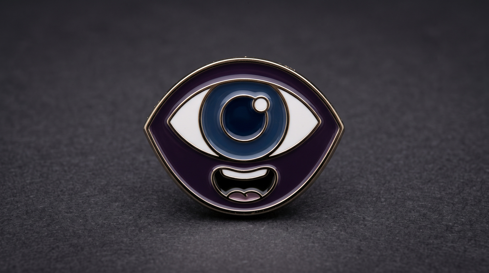
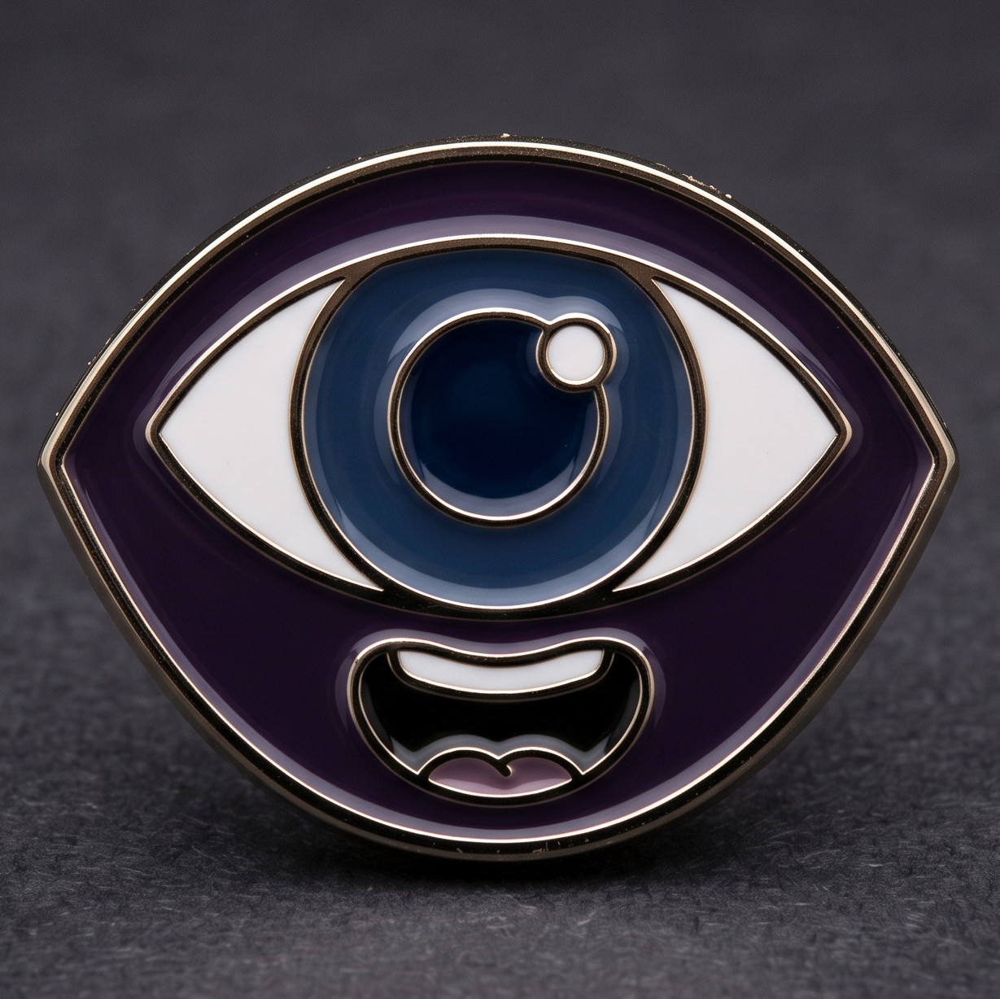

<div align="center">



# Olhos Falantes 👁️

### Aponte. Fotografe. Ouça.

**Um app que olha por você e conta, em voz alta, o que está na sua frente.**

</div>

---

## O que tem aqui na minha frente?

Uma mesa cheia de coisas. Um cômodo desconhecido. Um papel que chegou pelo correio. Para quem não enxerga, ou enxerga pouco, perguntas simples como essas viram um obstáculo do dia a dia.

Muitos aplicativos até tentam ajudar, mas escondem o botão certo atrás de menus, enchem a tela de anúncios ou respondem com um textão que ninguém tem paciência de ouvir.

**O Olhos Falantes responde em segundos, em português claro, e sem precisar enxergar a tela.**

---

## Como funciona

1. **Ligue o Olhos Falantes.** Com o [Node.js](https://nodejs.org) instalado e uma chave de serviço de visão no arquivo `.env` (veja o `env.example`), entre na pasta do projeto e rode:

   ```bash
   npm install   # só na primeira vez
   npm start
   ```

   👉 Abra **http://localhost:5173**, aceite o aviso e toque em **Começar**. Não precisa de cadastro.
2. **Tire uma foto.** Um botão grande, fácil de achar com o leitor de tela. Ou escolha uma foto que já está no celular.
3. **Ouça a cena.** Em poucos segundos chega uma descrição curta: o que tem ali, onde as coisas estão e os textos que aparecem. Toque em **Ouvir** e pronto.

Quer ouvir de novo? É só tocar outra vez.

---

## Por que você vai gostar

### 🦮 Feito para quem não vê a tela
Funciona do começo ao fim com o TalkBack. Botões enormes, alto contraste e cada controle com nome claro. Nada depende de cor, de mouse ou de olhar para a tela.

### 🗣️ Nunca te deixa no silêncio
Enquanto a foto é analisada, o app avisa o que está acontecendo: "Analisando...", "Pronto". Você sempre sabe em que pé as coisas estão.

### ✂️ Direto ao ponto
Nada de romance. A descrição fala primeiro do que importa e cabe em poucas frases. Quer mais detalhes? Escolha entre **Curta**, **Média**, **Longa** ou **Total**.

### 🤔 Honesto quando não tem certeza
Foto escura, tremida ou cortada? Em vez de inventar, ele diz que não conseguiu entender e pede outra foto.

### 🎙️ A voz que você preferir
Use a voz do próprio celular ou escolha uma das vozes em português do app. E o texto fica sempre na tela também, para quem enxerga pouco ou para conferir depois.

### 📱 No celular e no computador
Funciona no Chrome do Android e no navegador do computador, e pode ser instalado como um app com ícone na tela inicial.

---

## Feito com respeito a você

- ✅ A câmera só liga quando você toca no botão.
- ✅ Sua foto é usada para a descrição e descartada. Nada é guardado.
- ✅ Nunca diz quem é uma pessoa, nem idade, gênero ou emoção. No máximo, conta onde ela está e o que está fazendo, se você permitir.
- ✅ Nada de contas, cadastro, anúncios ou histórico na nuvem.

---

## Pra quem é

- 🦯 **Pessoas cegas** que querem saber o que está ao redor, na hora.
- 👓 **Pessoas com baixa visão** que se beneficiam de texto grande e voz.
- 💜 **Familiares e amigos** que querem dar mais autonomia a quem amam.

> O Olhos Falantes é uma ajuda para o dia a dia, não substitui a orientação de um profissional. Não use para ler documentos confidenciais, cartões ou dados bancários, nem para decisões de saúde ou segurança.

---

<div align="center">



**Aponte a câmera. O Olhos Falantes conta o resto. 👁️🗣️**

</div>
